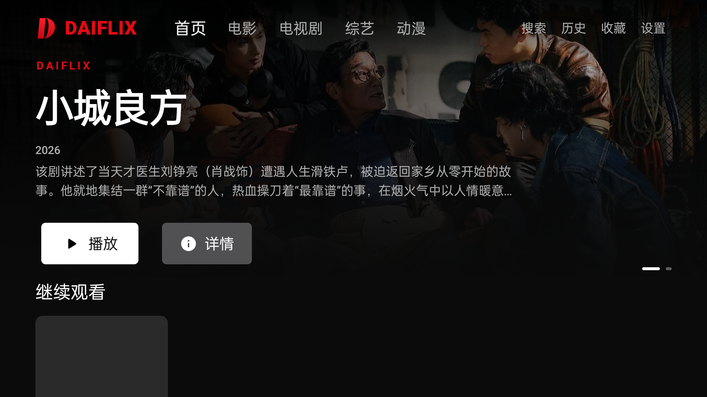
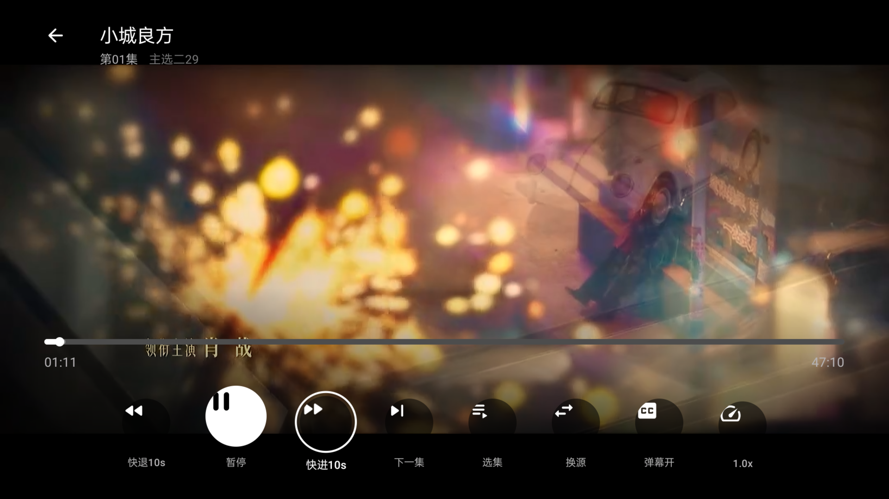

# Daiflix

[](https://github.com/y-zion/daiflix/actions/workflows/ci.yml)
[](LICENSE)
-3DDC84?logo=android&logoColor=white)


面向 Android TV 的影视聚合客户端，仿 Netflix 的大屏浏览与播放体验：全屏 Hero、横向海报流、遥控器友好的焦点系统，以及一套自绘的播放器控制层。数据来自第三方站点的公开网页结构（MacCMS 模板），本仓库只包含客户端代码，不包含、不存储、不分发任何视频内容。

## 截图

| 首页（全屏 Hero + 横向海报流） | 播放器（自绘 TV 控制层） |
| --- | --- |
|  |  |

## 功能

- **首页**：全屏 Hero（品牌、标题、元数据、播放/收藏按钮）+ 「继续观看」+ 各分类推荐横向海报流
- **分类浏览**：电影 / 电视剧 / 综艺 / 动漫，海报网格
- **搜索**：站点 `/ajax/suggest` 接口 + 遥控器可操作的电视端软键盘 + 搜索历史
- **详情**：多播放线路、选集、收藏、续播入口、相关推荐
- **播放器**：Media3 ExoPlayer + HLS，自绘 TV 控制层（进度条、快退/快进 10 秒、暂停、选集、换源、倍速、弹幕开关），断点续播、自动下一集、弹幕
- **历史 / 收藏**：本地 Room 持久化
- **设置**：数据源地址、播放偏好、清除历史、关于（版本号、开源信息）

## 设计与交互

- 深色（近黑 `#0B0B0B`）+ 品牌红 `#E50914` 的 Netflix 风格配色，全屏海报与多层渐变蒙版
- 所有可交互元素都有明显的电视焦点态：1.08 倍放大 + 2dp 白色描边，方向键移动焦点、OK 确认、BACK 返回
- 顶部导航在首页透明浮于 Hero 之上，进入其他页面变为实底
- 播放器控制层：任意按键唤出、4 秒无操作自动隐藏（暂停/打开面板时不隐藏）；左右键快退/快进 10 秒并显示提示；BACK 依次关闭面板 → 隐藏控制层 → 退出播放
- 播放器内可完成选集、换源、倍速、弹幕开关，无需退出重进

## Debug 与正式包

| | 正式包 | Debug 包 |
| --- | --- | --- |
| 包名 | `com.yzion.daiflix.tv` | `com.yzion.daiflix.tv.debug` |
| 应用名 | Daiflix | Daiflix Debug |
| Logo / Banner | 品牌 D | 品牌 D + 右上角琥珀色 `DEBUG` 角标 |
| 应用内导航栏 | 仅 DAIFLIX 字标 | DAIFLIX 字标 + `DEBUG` 角标 |

两个包可同时安装，互不覆盖。

## 技术栈

- Kotlin 2.0.21，Jetpack Compose for TV（`androidx.tv:tv-material3`）
- MVVM + StateFlow + Hilt
- Retrofit + OkHttp + Jsoup（HTML / JSON 解析）
- Room（观看历史 / 搜索历史 / 收藏）
- Media3 ExoPlayer + HLS，自绘播放器 HUD
- Coil（豆瓣图片自动补 Referer）

## 构建

要求：JDK 17、Android SDK 35。

```bash
git clone https://github.com/y-zion/daiflix.git
cd daiflix
export JAVA_HOME=/opt/homebrew/opt/openjdk@17   # macOS 示例
./gradlew :app:assembleDebug
```

产物：`app/build/outputs/apk/debug/app-debug.apk`（包名 `com.yzion.daiflix.tv.debug`）。

```bash
./gradlew :app:testDebugUnitTest   # 单元测试
./gradlew :app:lintDebug           # 静态检查
```

> AGP 8.7.3 自带的 lint 与 lifecycle 2.8.7 / Compose 1.7 的部分 UAST 检测器不兼容，`app/build.gradle.kts` 中禁用了会崩溃的检测器，其余检查正常执行。

## 签名发布

未配置签名时 `assembleRelease` 产出 unsigned APK。配置以下环境变量后会生成已签名包：

```bash
export DAIFLIX_KEYSTORE_FILE=/absolute/path/release.jks
export DAIFLIX_KEYSTORE_PASSWORD=...
export DAIFLIX_KEY_ALIAS=...
export DAIFLIX_KEY_PASSWORD=...
./gradlew :app:assembleRelease
```

GitHub Actions 的 `Release` 工作流使用同名 Secrets（`DAIFLIX_KEYSTORE_BASE64` / `DAIFLIX_KEYSTORE_PASSWORD` / `DAIFLIX_KEY_ALIAS` / `DAIFLIX_KEY_PASSWORD`）签名。R8 已开启（minify + shrinkResources），发版前请安装 release 包做一次完整回归。

### 自动发版

推送到 `main` 时 `Release` 工作流会自动检查版本号：只要 `app/build.gradle.kts` 里的 `versionName` 高于最新 `v*` tag，就自动跑单测、构建并校验签名、打 `vX.Y.Z` tag、发布 GitHub Release（资产 `Daiflix-vX.Y.Z.apk` 与 `SHA256SUMS.txt`）。版本号没变或更低时只跑检测，不会重复发布。

发版步骤：

1. 修改 `app/build.gradle.kts`：`versionName` 改成新版本（如 `"2.1.0"`），`versionCode` 必须同步严格递增（如 `4`），否则工作流会报错并终止。
2. 在 `CHANGELOG.md` 顶部新增 `## [2.1.0] — YYYY-MM-DD` 小节，其内容会作为 Release 说明。
3. 提交并推送到 `main`，等 `Release` 工作流跑完即可。

也可以手动触发：在 Actions 页面运行 `Release` 工作流（用于按当前版本重试发布），或推送与 `versionName` 一致的 `vX.Y.Z` tag。

## 数据源与配置

- 默认数据源：`https://vidhub3.top`，可在「设置 → 数据源地址」修改
- 播放地址解析：`/vodplay/{id}-{线路}-{集数}.html` → iframe 中的 `u` 参数 → `/player/api/resolve.php?u=...` → HLS
- 站点搜索页有人机验证，客户端改用无需验证的 `/ajax/suggest`，因此搜索结果按关键词匹配、不带分页
- 豆瓣图片需要 `Referer: https://movie.douban.com/`，已在 Coil 图片客户端中处理

## 项目结构

```
app/src/main/java/com/yzion/daiflix/tv/
├── data/          # 网络、HTML 解析、Room、偏好设置
├── di/            # Hilt 模块
├── ui/
│   ├── component/ # 品牌、卡片、导航、播放器 HUD 等可复用组件
│   ├── navigation/# 类型安全路由
│   ├── screen/    # 首页 / 分类 / 详情 / 播放 / 搜索 / 历史 / 收藏 / 设置
│   ├── theme/     # 颜色、字号、间距、卡片尺寸
│   └── viewmodel/ # MVVM 状态
└── MainActivity.kt
```

## 已知限制

- 仅基于网页结构抓取，站点改版会导致解析失败
- 分类页没有真正的下一页，客户端只加载第一页
- 不支持下载与清晰度切换（站点只暴露单一 HLS 主播放列表）
- 弹幕来自站点接口，内容与可用性由站点决定

## 免责声明

本项目仅用于学习与技术研究，不存储、不分发任何影视资源。数据与播放地址均来自第三方站点，请遵守当地法律与站点条款。若相关站点或权利人认为内容不妥，请提交 issue，我们会及时处理。

## License

[MIT](LICENSE)
